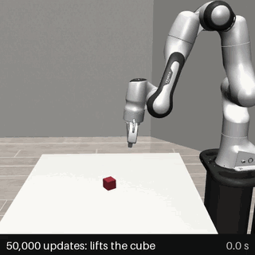
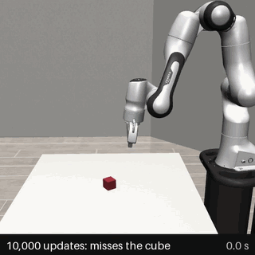
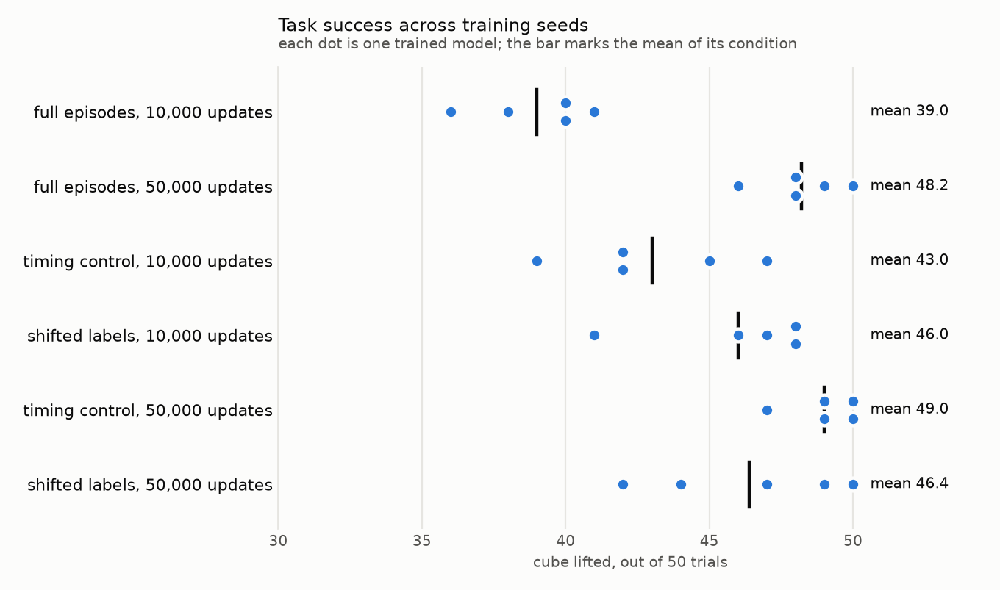

# Demo2Policy

Behavior cloning on robosuite Lift from 160 human demonstrations, with an evaluation built
so no reported number could have been influenced by the data it is measured on.

| 50,000 updates: lifts the cube | 10,000 updates: misses |
| --- | --- |
|  |  |

## Result

**96% success** (241/250 trials, 95% interval 91–100%) from unseen start states, over five
independently trained models. The robomimic paper reports 100% on this task using the best
checkpoint found during training; this reports the last checkpoint on states never used for
any choice.

| Training | Success per model (of 50) | Mean |
| --- | --- | --- |
| 10,000 updates | 40, 36, 40, 41, 38 | 78% |
| 50,000 updates | 48, 48, 46, 50, 49 | 96% |



## Findings

- **Failures happen at the grasp:** the gripper arrives about 28 mm off target (human: 6 mm).
- **The policy never recovers from a miss:** the demonstrations contain no retries.
- **Offline error is a weak proxy:** it fell 6% while success rose from 78% to 96%.
- **An early single-model win did not replicate** across five seeds.

## Evaluation

- Demonstrations split by whole episode (160 train / 20 validation / 20 test).
- Rules and checkpoint choice fixed before each training run.
- Development and final test states kept separate; each final set used once.
- Five seeds, every trial recorded and replayable.

## Reproduce

```sh
make setup            # pinned environment (needs git, uv)
make check            # recount all results from the trial records, in seconds
make reproduce-quick  # one model end to end, ~5 min
make reproduce        # all results, ~47 min, ends with REPRODUCED
```

Tested on macOS (Apple Silicon, CPU), Python 3.11. Full details: [`docs/results.md`](docs/results.md).

## Credits

Built on [robomimic](https://github.com/ARISE-Initiative/robomimic),
[robosuite](https://github.com/ARISE-Initiative/robosuite) and
[MuJoCo](https://github.com/google-deepmind/mujoco). Demonstrations: robomimic Lift
proficient-human (Mandlekar et al. 2021, [arXiv:2108.03298](https://arxiv.org/abs/2108.03298)),
not included. MIT licensed, see [`LICENSE`](LICENSE).
