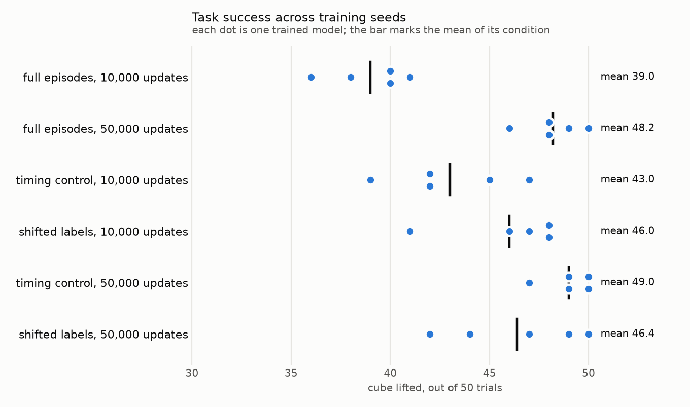

# Results

All counts can be recomputed from the per-trial records in `artifacts/` with
`python -m scripts.report`.

## Setup

| | |
| --- | --- |
| Data | robomimic Lift, proficient-human, low-dim: 200 episodes, 36–64 steps each |
| Observations | gripper position and orientation, finger positions, cube pose (19 numbers) |
| Actions | gripper motion and open/close command (7 numbers), 20 Hz |
| Split | whole episodes: 160 train, 20 validation, 20 test (`artifacts/split_manifest.json`) |
| Model | robomimic BC, MLP 256×256, MSE loss, Adam 1e-4, batch 128, CPU |
| Success | cube lifted more than 4 cm within 400 steps |

## Main result

Each setting trained with five seeds, evaluated at the last checkpoint on the same 50 unseen
start states.

| Training data | Updates | Lifted per seed (of 50) | Mean |
| --- | --- | --- | --- |
| Full episodes | 10,000 | 40, 36, 40, 41, 38 | 78% |
| Full episodes | 50,000 | 48, 48, 46, 50, 49 | **96%** |
| Trimmed episodes | 10,000 | 42, 42, 39, 47, 45 | 86% |
| Trimmed, labels shifted 3 steps | 10,000 | 48, 46, 48, 47, 41 | 92% |
| Trimmed episodes | 50,000 | 50, 49, 47, 50, 49 | 98% |
| Trimmed, labels shifted 3 steps | 50,000 | 47, 50, 49, 42, 44 | 93% |

| Comparison (paired by seed) | Better / equal / worse | Difference, 95% interval |
| --- | --- | --- |
| 50,000 vs 10,000 updates | 5 / 0 / 0 | +8 to +30 points |
| Shifted vs unshifted labels, 10,000 | 3 / 1 / 1 | −5 to +18 points |
| Shifted vs unshifted labels, 50,000 | 2 / 0 / 3 | −14 to +2 points |

Longer training helps in every seed. Shifting the labels has no reliable effect, although
it looked like a clear win (50 vs 45) in the first single-model run.

## Why grasps fail

On 100 separate diagnosis states the 10,000-update model lifted 84. Distance between gripper
and cube when it closed (or at closest approach, if it never closed):

| | Trials | Median | Range |
| --- | --- | --- | --- |
| Human demonstrations | 40 | 6 mm | 2–19 mm |
| Model, successes | 84 | 12 mm | 1–37 mm |
| Model, failures | 16 | 28 mm | 11–101 mm |

The policy arrives at the right time but in the wrong place. Of the 16 failures, 7 closed
and missed and 9 never closed. Failures were more common with the cube rotated near 45°.

After a miss the policy never retries: every failed trial runs to the step limit, often with
the arm drifting far above anything in the demonstrations. The demonstrations contain no
missed grasps, so there is nothing to learn a retry from.

## What fixed it

Single runs on the diagnosis states:

| Updates | MLP 256 | MLP 1024 | MLP 1024 + GMM |
| --- | --- | --- | --- |
| 10,000 | 84 | 97 | 95 |
| 50,000 | 99 | 96 | 96 |
| 200,000 | 99 | 88 | 97 |

Training the small network longer was enough: success went from 84 to 99 and the median
aiming error fell from 12.9 mm to 10.4 mm. The larger network helped early but got worse
with long training. On 50 new states the 50,000-update model lifted 50/50 against 46/50 for
the original model; the multi-seed result above confirms it.

## Offline error vs success

| Change | Validation/test error | Success |
| --- | --- | --- |
| 10,000 → 50,000 updates (five seeds) | −6% | 78% → 96% |
| Shifted vs unshifted labels (10,000) | +35% | 92% vs 86% |
| MLP 1024, 50,000 → 200,000 updates | +33% | 96 → 88 of 100 |

Held-out action error barely tracks task success and can rank policies the wrong way, so
every result here comes from running the policy in the simulator.

## Evaluation rules

- Episodes are never split across train and test.
- Rules and checkpoint choice are fixed before each training run (`configs/protocol_*.json`).
- States used for choosing are never used for reporting; each reporting set is used once.
- Intervals resample both seeds and start states, since all models share the same states.

## Compared with robomimic

The robomimic paper reports 100% for BC on this task, using the best checkpoint found during
training, a larger network (1024 + GMM) and 200,000 updates. This project reports the last
checkpoint on states never used for any choice, so the numbers are consistent but not
directly comparable.

## Limitations

- One simulated task with simulator-state observations; nothing here covers images or hardware.
- Five seeds detect large effects only; the network-size results are single runs.
- Results vary with the start states drawn (the same model lifted 43, 46 and 40 of 50 on three sets).
- Success counts the first moment the cube is lifted; holding it is not required.
- `mujoco==3.2.7` is required with robosuite 1.5.1.

## References

- Mandlekar et al. 2021, *What Matters in Learning from Offline Human Demonstrations for
  Robot Manipulation*, [arXiv:2108.03298](https://arxiv.org/abs/2108.03298)
